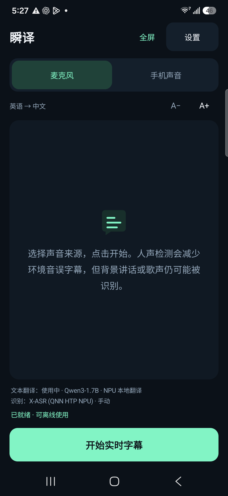
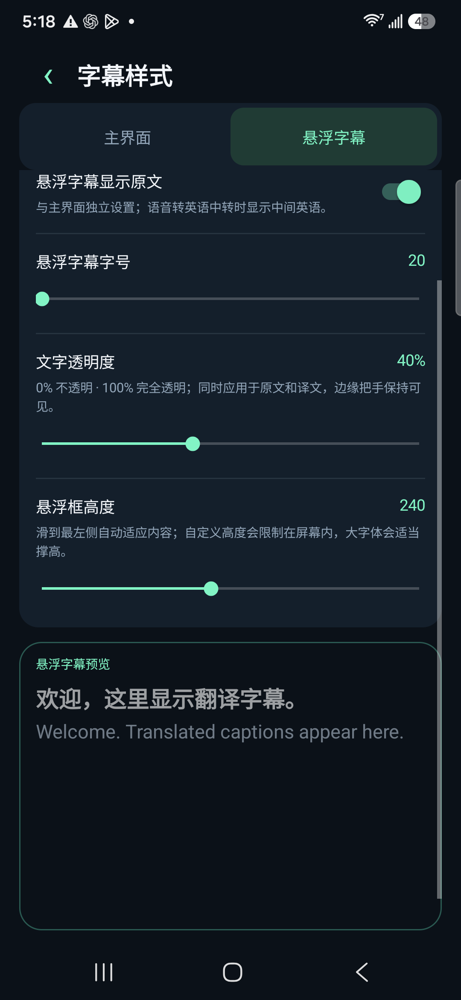

# Instant Caption · 瞬译

## Free AI simultaneous interpretation. Low latency. Local language models.

**A free Android AI interpretation app that turns speech into live translated captions — powered by language models running on your phone.** Microphone and device-audio input, floating subtitles, and chipset-aware NPU integration. No subscription or cloud translation API key.

[**Download APK**](https://github.com/zmxhot/InstantCaption/releases/tag/v1.20.1-beta.1) · [Get started](#get-started) · [Compatibility](docs/COMPATIBILITY.md) · [Optional donations](docs/SUPPORT.md)

**English** · [简体中文](README.zh-CN.md) · [Español](docs/i18n/README.es.md) · [Français](docs/i18n/README.fr.md) · [Deutsch](docs/i18n/README.de.md) · [Português](docs/i18n/README.pt.md) · [Русский](docs/i18n/README.ru.md) · [日本語](docs/i18n/README.ja.md) · [한국어](docs/i18n/README.ko.md) · [العربية](docs/i18n/README.ar.md)

> **Public beta · Android 10+ · ARM64.** The signed APK currently available uses portable CPU models. Full NPU integration is included in the source; its prebuilt APK is withheld while upstream binary-license mapping is clarified. [Distribution status](docs/NPU-DISTRIBUTION.md). Install the APK, then download the required models inside the app once; recognition and translation can then run offline. Model weights are not bundled in the APK.

## What makes it useful

- **Free AI interpretation:** live translated text subtitles, with no subscription or paid feature unlocks. Donations are voluntary.
- **Local large language models:** use HY-MT2-1.8B for direct multilingual CPU translation, or smaller OPUS-MT routes. The full integration also supports matching Qwen3 and Gemma NPU exports.
- **Low-latency streaming:** speech activity detection, short segments and a bounded processing queue reduce waiting. Actual speed depends on model, phone, language and temperature.
- **Private, on-device inference:** speech recognition and text translation run locally after setup. No Google Translate SDK, Google Play services requirement, cloud translation API or API key.
- **Microphone or device audio:** translate nearby speech or audio from apps that allow Android playback capture.
- **Floating captions:** drag the whole panel, tuck it against an edge and reopen it using its handle. Adjust font size, text transparency and height. Show original text independently on the main screen and overlay. Only floating captions clear after 60 seconds without new speech.
- **Independent model management:** separate speech and text model lists with downloads, switching, deletion and import. Recommendations use processor, Android version and RAM; downloads support resume and checksums.
- **Ten interface languages:** English, Chinese, Spanish, French, German, Portuguese, Russian, Japanese, Korean and Arabic. Follow the system with English fallback. Available speech/subtitle languages depend on the selected models.

  
  

*Screenshots from the development NPU build. The public portable APK has the same caption UI with CPU-compatible model choices.*

## Get started

1. Download **`instant-caption-1.20.1-beta.1-portable-release.apk`** from [Releases](https://github.com/zmxhot/InstantCaption/releases/tag/v1.20.1-beta.1) and install it. **No compilation required.**
2. Choose spoken and subtitle languages. Default: English → device language; on English devices, Spanish → English.
3. Download the recommended speech/text models over Wi-Fi, or import matching model files. The app shows download size and disk space. For direct multilingual LLM translation, choose **HY-MT2-1.8B** when supported: about 1.13 GB for the text model, plus a speech model; 6 GB+ RAM preferred.
4. Run the local model check. Select **Microphone** or **Device audio**, grant the corresponding permission and start captions.
5. After the models are ready, recognition and translation can run offline. Public portable models need no account or subscription.

Public app ID: `com.localcaption.instant`. Maintainer test installations ending in `.npu` are separate. Preserve old model files and use import when migrating; do not uninstall a test build before saving needed models.

## NPU and measured latency

The source integrates Qualcomm QNN/GenieX and LiteRT-LM vendor backends. Model availability follows documented chipset/runtime combinations and Android/RAM requirements. **Having an NPU does not make every NPU model compatible.** Unknown targets retain portable paths; individual handset testing is not a download whitelist.

Historical development measurements on **Samsung Galaxy S25+ / SM8750**:

| Measurement | Median | Scope |
| --- | --- | --- |
| First translated caption from audio start | 1.461 s | 1.18 NPU development build, SenseVoice + Gemma4, repeated fixture over 30 minutes |
| Gemma4 NPU text inference | 324 ms | 1.19 build, 94 short authored cases across ten languages |
| HY-MT2-1.8B CPU text inference | 1,768 ms | Same 94-case test set; portable text backend |

Text inference excludes speech recognition, loading and segmentation. NPU figures **do not describe the downloadable portable APK** and are not promises for other devices. [Streaming evidence](docs/catalog/1.18-verification.json) · [Text results](docs/catalog/1.19-verification.json) · [Quality cases](docs/catalog/1.19-text-quality.json) · [Latest package checks](docs/catalog/1.20.1-release.json).

## Practical limits and privacy

Device-audio mode uses Android's screen-sharing consent API to obtain playback **audio**. This app captures no screen images or video. Calls, protected media and apps that prohibit capture may be unavailable.

Voice activity detection reduces environmental captions, but background speech, singing and recognition errors remain possible. Translations may omit or change meaning; short fragments and English-pivot routes can reduce quality. Large models need storage and free RAM. Thermal throttling and battery management affect speed. Downloads need internet; inference is local. See [Privacy](PRIVACY.md).

This APK supports ARM64 Android 10+; ARM32, x86 and iOS are outside its supported platforms.

## Contribute and license

[Build](docs/BUILD.md) · [Testing](docs/TESTING.md) · [Contributing](CONTRIBUTING.md) · [Report a bug](https://github.com/zmxhot/InstantCaption/issues) · [Security](SECURITY.md) · [Changelog](CHANGELOG.md)

Please include device/processor, Android version, app version, models, language pair and reproduction steps. Settings can export diagnostics without audio or transcript content. Native-speaker reviews and real-device reports are welcome. GitHub Actions builds portable debug artifacts; use the signed Release APK for everyday installation.

Application source: **Apache-2.0**. Models and vendor libraries retain separate licenses and usage restrictions. Preserve [LICENSE](LICENSE), [NOTICE](NOTICE) and bundled third-party texts. Review [NPU distribution status](docs/NPU-DISTRIBUTION.md) before distributing a full NPU build.

## Support development — completely optional

If this free app helps you, donations support maintenance and device testing. **No payment is needed for translation, downloads or model selection.**

[**PayPal · Alipay · WeChat Pay · Bitcoin · Solana**](docs/SUPPORT.md)
