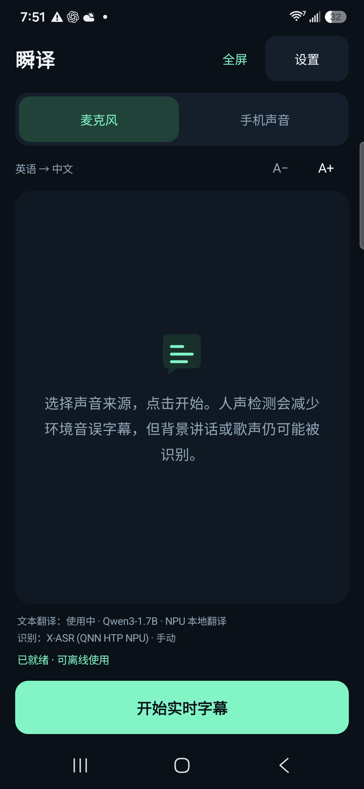
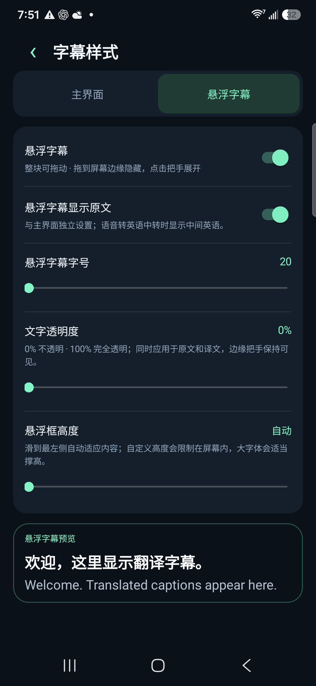

# 瞬译 · Instant Caption

## 免费 AI 同声传译 APP · 低延迟 · 手机本地大模型

**把语音实时翻译成字幕，让 AI 大模型在手机本地运行。** 支持麦克风、手机声音、悬浮字幕与源码中的 NPU 加速适配。免费使用，无订阅费，无需云端翻译 API Key。

[**下载 APK**](https://github.com/zmxhot/InstantCaption/releases/tag/v1.20.1-beta.1) · [兼容说明](docs/COMPATIBILITY.md) · [自愿打赏](docs/SUPPORT.md) · [English](README.md)

[Español](docs/i18n/README.es.md) · [Français](docs/i18n/README.fr.md) · [Deutsch](docs/i18n/README.de.md) · [Português](docs/i18n/README.pt.md) · [Русский](docs/i18n/README.ru.md) · [日本語](docs/i18n/README.ja.md) · [한국어](docs/i18n/README.ko.md) · [العربية](docs/i18n/README.ar.md)

> **公开测试版 · Android 10+ · ARM64。** 当前发布正式签名的通用 CPU APK，下载安装后可直接开始配置，无需自行编译。首次需在应用内下载所需模型，之后可离线运行。完整 NPU 适配源码已包含；部分上游二进制组件的许可对应关系仍待澄清，本次暂不上传完整 NPU 候选 APK。[分发许可状态](docs/NPU-DISTRIBUTION.md)

## 主要特点

- **免费 AI 同声传译**：以实时翻译字幕呈现，无订阅费，无付费解锁，打赏完全自愿。
- **手机本地大模型**：通用版可选 HY-MT2-1.8B，直接进行多语言翻译；也可选较小的 OPUS-MT 路线。完整源码还支持对应处理器的 Qwen3、Gemma NPU 模型。
- **流式低延迟**：人声检测、小段语音处理与有界队列减少等待，实际速度随手机、模型、语言及温度变化。
- **本地推理与隐私**：识别和翻译在手机上完成，不调用云端翻译 API，不依赖 Google Play 服务或谷歌翻译。
- **两种音源**：麦克风收音，或允许 Android 内录的应用声音。
- **自由悬浮字幕**：整个窗口可拖动，贴边隐藏后用小按钮展开；可调字号、文字透明度、高度；主屏和悬浮原文显示独立设置。悬浮 60 秒没有新人声时清屏，主屏历史保留。
- **两类模型独立管理**：识别与翻译分别选择、下载、导入、删除。根据处理器、系统与内存推荐模型，支持断点续传、备用来源和校验。
- **10 种界面语言**：英、中、西、法、德、葡、俄、日、韩、阿拉伯语。默认跟随系统，未支持语言回退英文；语音和字幕语言范围由所选模型决定。

  
  

*简体中文界面，使用 Galaxy S25+ 上的 NPU 开发版实机截图。预览展示译文与英文原文；公开通用 APK 使用 CPU 模型。*

## 下载与使用

1. 在 [Release 下载页](https://github.com/zmxhot/InstantCaption/releases/tag/v1.20.1-beta.1) 下载 **`instant-caption-1.20.1-beta.1-portable-release.apk`** 并安装，无需自己编译。
2. 跟随引导选择说话语言和字幕语言。默认英语 → 本机语言；本机为英语时默认西班牙语 → 英语。
3. 使用 Wi-Fi 下载推荐模型，或导入匹配的模型文件。应用会显示下载量与所需空间。希望使用直接多语言大模型翻译时，可选择 **HY-MT2-1.8B**：文本模型约 1.13 GB，语音模型另算，建议 6 GB 及以上内存。
4. 运行本地模型检查，选择“麦克风”或“手机声音”，授予对应权限后开始字幕。
5. 模型准备完成后，识别和翻译可离线运行。公开通用模型无需账户或订阅。

公开包名为 `com.localcaption.instant`；开发测试版 `.npu` 为独立应用。迁移前保留所需模型并通过导入复用，避免提前卸载导致文件丢失。

## NPU 与低延迟实测

源码集成 Qualcomm QNN/GenieX 与 LiteRT-LM 厂商后端，按官方文档、对应二进制目标、系统及内存匹配模型。**有 NPU 不代表能运行任意 NPU 模型**，未适配目标保留通用 CPU 路线；不会用逐机型测试白名单限制下载。

以下为三星 Galaxy S25+／SM8750 开发测试历史数据：

| 项目 | 中位数 | 条件 |
| --- | --- | --- |
| 音频开始至首条译文字幕 | 1.461 秒 | 1.18 NPU 开发版、SenseVoice + Gemma4，固定音频重复测试 30 分钟 |
| Gemma4 NPU 文本翻译 | 324 毫秒 | 1.19 构建、10 种语言共 94 条自编短文本 |
| HY-MT2-1.8B CPU 文本翻译 | 1,768 毫秒 | 同一组 94 条短文本，通用文本后端 |

文本耗时不含识别、加载和分段等待。**NPU 数据不代表本次公开 CPU APK 的性能，也不是所有手机的保证。** [流式证据](docs/catalog/1.18-verification.json) · [文本测试](docs/catalog/1.19-verification.json) · [逐条质量](docs/catalog/1.19-text-quality.json) · [最新打包检查](docs/catalog/1.20.1-release.json)

## 使用边界与隐私

手机声音模式借用 Android“共享屏幕”授权接口获取播放音频，应用不捕获屏幕图像或视频。电话、受保护媒体及禁止内录的应用可能无法获取声音。

人声检测能减少环境音误字幕，但无法保证排除背景说话、歌声与全部识别错误。短句、口音和英语中转可能影响翻译质量。大模型需要空间和可用内存，发热与省电策略也会影响速度。下载需联网，推理在本地运行。详见[隐私说明](PRIVACY.md)。本 APK 支持 ARM64 Android 10+，不支持 ARM32、x86、iOS。

## 开发、反馈与许可

[编译](docs/BUILD.md) · [测试](docs/TESTING.md) · [兼容配置](docs/COMPATIBILITY.md) · [反馈问题](https://github.com/zmxhot/InstantCaption/issues) · [更新记录](CHANGELOG.md)

反馈请提供手机/处理器、系统、应用版本、模型、语言组合和复现步骤。设置可导出不含语音、字幕正文的诊断信息。欢迎不同机型测试和母语校对。GitHub Actions 产物为调试构建，日常安装请选择 Release 中的正式签名 APK。

应用源码采用 **Apache-2.0**；模型和厂商运行库遵守各自许可及用途限制，须保留 [LICENSE](LICENSE)、[NOTICE](NOTICE) 与第三方声明。完整 NPU 分发前请查看[许可核对](docs/NPU-DISTRIBUTION.md)。

## 自愿支持开发

如果这个免费 APP 对你有帮助，可通过 [**PayPal、支付宝、微信、比特币或 Solana**](docs/SUPPORT.md) 自愿打赏，支持维护与机型测试。**不打赏也能使用翻译、模型下载和全部已提供功能。**
