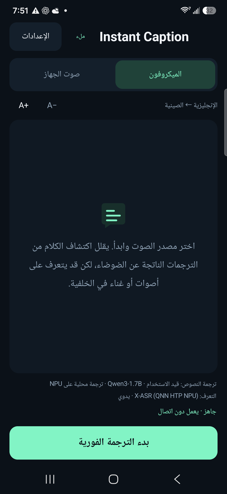
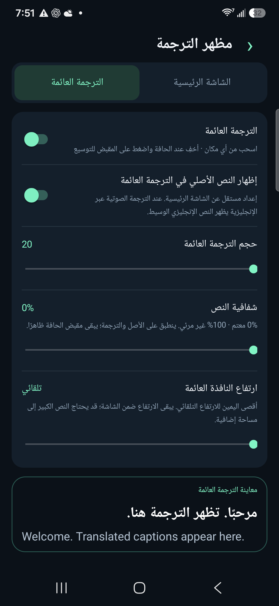

# Instant Caption · تطبيق مجاني للترجمة الفورية بالذكاء الاصطناعي

[English](../../README.md) · [简体中文](../../README.zh-CN.md) · [Español](README.es.md) · [Français](README.fr.md) · [Deutsch](README.de.md) · [Português](README.pt.md) · [Русский](README.ru.md) · [日本語](README.ja.md) · [한국어](README.ko.md) · [العربية](README.ar.md)

## مترجم دون إنترنت لنظام Android · ترجمة نصية مباشرة · زمن استجابة منخفض

Instant Caption تطبيق مجاني ومفتوح المصدر للترجمة الصوتية والفورية بالذكاء الاصطناعي على Android. يعرض ترجمة نصية مباشرة وعائمة باستخدام نماذج لغوية كبيرة (LLM) تعمل محليًا على هاتفك. بعد تنزيل النماذج، يعمل التعرّف على الكلام والترجمة دون إنترنت. ترجم صوت الميكروفون أو صوت الفيديو والتطبيقات التي تسمح بالتقاط الصوت، بزمن استجابة منخفض. لا يتطلب اشتراكًا أو مفتاح API لترجمة سحابية أو خدمات Google Play. التبرعات اختيارية.

[**تنزيل APK**](https://github.com/zmxhot/InstantCaption/releases/tag/v1.20.1-beta.1)

> إصدار تجريبي عام لأجهزة ARM64 بنظام Android 10 أو أحدث. ملف APK الموقّع المتاح يستخدم نماذج CPU. يتضمن المصدر تكامل NPU، لكن نشر APK الكامل لـ NPU مؤجل حتى توضيح تراخيص بعض الاعتماديات الثنائية. [حالة التوزيع](../NPU-DISTRIBUTION.md)

### الميزات

- التعرّف على الكلام والترجمة محليًا بعد تنزيل النماذج، دون اشتراط خدمات Google Play.
- نموذج HY-MT2-1.8B للترجمة المباشرة متعددة اللغات، أو مسارات OPUS-MT الأصغر. يدعم التكامل الكامل إصدارات Qwen/Gemma المناسبة لوحدات NPU المتوافقة.
- الإدخال من الميكروفون أو صوت التطبيقات التي تسمح بالتقاط الصوت في Android.
- ترجمة عائمة قابلة للسحب والإخفاء عند الحافة، مع ضبط حجم الخط والشفافية والارتفاع وعرض النص الأصلي.
- إدارة منفصلة لنماذج الكلام والترجمة، مع استئناف التنزيل والاستيراد والتحقق من سلامة الملفات.
- عشر لغات للواجهة؛ تعتمد لغات الكلام والترجمة المتاحة على النماذج المختارة.

### لقطات الشاشة

  
  

*واجهة عربية ملتقطة على Galaxy S25+ باستخدام نسخة التطوير التي تدعم NPU. تعرض المعاينة الترجمة والنص الأصلي بالإنجليزية. يستخدم ملف APK المنشور نماذج CPU.*

### البدء

1. نزّل وثبّت `instant-caption-1.20.1-beta.1-portable-release.apk`. لا تحتاج إلى تجميع المصدر.
2. اختر لغة الكلام ولغة الترجمة، ثم نزّل النماذج الموصى بها عبر Wi-Fi.
3. للترجمة المباشرة بنموذج لغوي، اختر HY-MT2-1.8B إذا كان الجهاز متوافقًا. حجمه نحو 1.13 GB إضافة إلى نموذج الكلام، ويُفضّل توفر 6 GB من RAM أو أكثر.
4. شغّل فحص النموذج المحلي، واختر الميكروفون أو صوت الجهاز وامنح الإذن المطلوب. بعد تجهيز النماذج يمكن العمل دون إنترنت.

يعتمد زمن الاستجابة على الجهاز والنموذج والحرارة. قياسات NPU في README الإنجليزي لا تمثل أداء APK الذي يستخدم CPU. قد تحدث أخطاء ترجمة. يُستخدم إذن مشاركة الشاشة للحصول على الصوت، دون التقاط صور الشاشة أو الفيديو؛ وقد لا تتاح المكالمات والمحتويات المحمية.

[التوافق](../COMPATIBILITY.md) · [الخصوصية](../../PRIVACY.md) · [البناء](../BUILD.md) · [الإبلاغ عن مشكلة](https://github.com/zmxhot/InstantCaption/issues) · [دعم اختياري](../SUPPORT.md)

ترخيص مصدر التطبيق هو Apache-2.0. تحتفظ النماذج والمكتبات بتراخيصها وقيود استخدامها الخاصة. لا تحتاج أي ميزة متاحة إلى تبرع.
