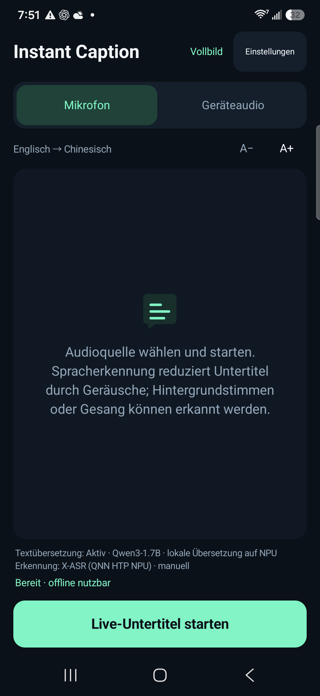
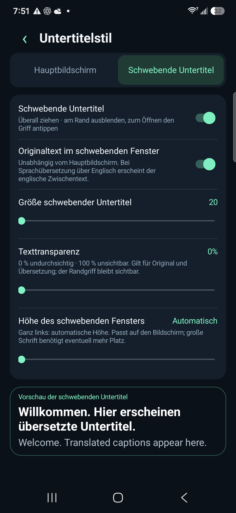

# Instant Caption · Kostenlose KI-Simultanübersetzung

[English](../../README.md) · [简体中文](../../README.zh-CN.md) · [Español](README.es.md) · [Français](README.fr.md) · [Deutsch](README.de.md) · [Português](README.pt.md) · [Русский](README.ru.md) · [日本語](README.ja.md) · [한국어](README.ko.md) · [العربية](README.ar.md)

## Geringe Latenz · Lokale Sprachmodelle · Android

Sprache wird in Echtzeit als übersetzter Untertitel angezeigt. Die KI-Modelle laufen auf deinem Smartphone. Kostenlos, ohne Abo und ohne API-Schlüssel für Cloud-Übersetzung. Spenden sind freiwillig.

[**APK herunterladen**](https://github.com/zmxhot/InstantCaption/releases/tag/v1.20.1-beta.1)

> Öffentliche Beta für Android 10+ und ARM64. Die verfügbare signierte APK verwendet CPU-Modelle. NPU-Unterstützung ist im Quellcode integriert; die vollständige NPU-APK wird erst nach Klärung offener Lizenzzuordnungen binärer Abhängigkeiten veröffentlicht. [Verteilungsstatus](../NPU-DISTRIBUTION.md).

### Funktionen

- Lokale Spracherkennung und Übersetzung nach dem Modelldownload, ohne Google-Play-Dienste als Voraussetzung.
- HY-MT2-1.8B für direkte mehrsprachige Übersetzung oder kleinere OPUS-MT-Pfade. Die vollständige Integration unterstützt passende Qwen/Gemma-NPU-Modelle.
- Mikrofon oder Ton aus Apps, die Android-Audioaufnahme erlauben.
- Verschiebbare Untertitel, am Rand ausblendbar; Schriftgröße, Transparenz, Höhe und Originaltext einstellbar.
- Getrennte Verwaltung von Sprach- und Textmodellen, fortsetzbare Downloads, Import und Integritätsprüfung.
- Zehn Oberflächensprachen; Sprach- und Übersetzungsoptionen hängen vom Modell ab.

### Screenshots

  
  

*Deutsche Oberfläche, aufgenommen auf einem Galaxy S25+ mit dem NPU-Entwicklungsbuild. Die Vorschau zeigt die Übersetzung und den englischen Ausgangstext. Das öffentliche APK verwendet CPU-Modelle.*

### Erste Schritte

1. `instant-caption-1.20.1-beta.1-portable-release.apk` herunterladen und installieren. Kein eigenes Kompilieren nötig.
2. Ausgangs- und Zielsprache wählen, empfohlene Modelle über WLAN herunterladen.
3. Für direkte Übersetzung mit einem Sprachmodell bei geeigneter Hardware HY-MT2-1.8B wählen: etwa 1,13 GB plus Sprachmodell; mindestens 6 GB RAM empfohlen.
4. Lokale Modellprüfung ausführen, Mikrofon oder Geräteton wählen und die jeweilige Berechtigung erteilen. Nach der Einrichtung ist Offline-Betrieb möglich.

Die Latenz hängt von Gerät, Modell und Temperatur ab. NPU-Messwerte im englischen README gelten nicht für die CPU-APK. Übersetzungen können Fehler enthalten. Die Android-Bildschirmfreigabe erlaubt hier den Audiozugriff; Bilder und Videos werden nicht aufgenommen. Anrufe und geschützte Inhalte können gesperrt sein.

[Kompatibilität](../COMPATIBILITY.md) · [Datenschutz](../../PRIVACY.md) · [Bauen](../BUILD.md) · [Fehler melden](https://github.com/zmxhot/InstantCaption/issues) · [Freiwillig spenden](../SUPPORT.md)

App-Quellcode: Apache-2.0. Modelle und Bibliotheken behalten eigene Lizenzen und Nutzungsbeschränkungen. Alle bereitgestellten Funktionen sind ohne Spende nutzbar.
