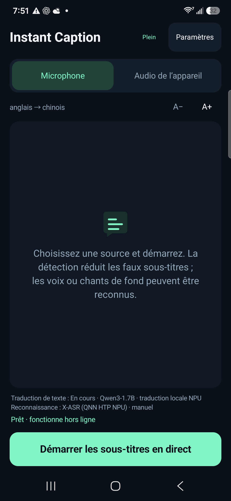
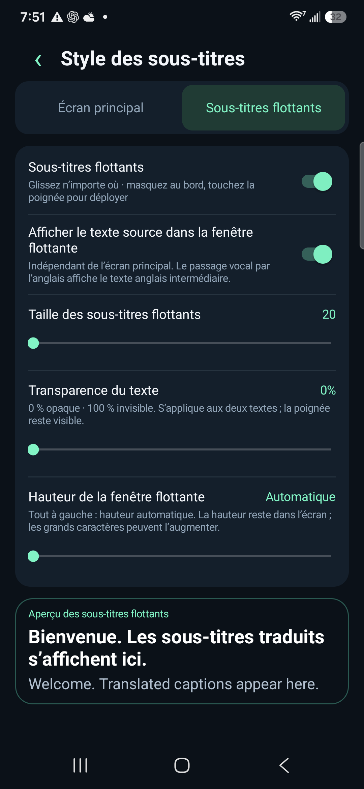

# Instant Caption · Interprétation simultanée par IA gratuite

[English](../../README.md) · [简体中文](../../README.zh-CN.md) · [Español](README.es.md) · [Français](README.fr.md) · [Deutsch](README.de.md) · [Português](README.pt.md) · [Русский](README.ru.md) · [日本語](README.ja.md) · [한국어](README.ko.md) · [العربية](README.ar.md)

## Faible latence · Modèles de langage locaux · Android

Transformez la parole en sous-titres traduits en temps réel grâce à des modèles exécutés sur votre téléphone. Gratuit, sans abonnement ni clé d’API de traduction dans le cloud. Les dons sont facultatifs.

[**Télécharger l’APK**](https://github.com/zmxhot/InstantCaption/releases/tag/v1.20.1-beta.1)

> Bêta publique pour Android 10+ et ARM64. L’APK signé disponible utilise le CPU. Le code intègre l’accélération NPU, mais l’APK NPU complet reste en attente de clarification des licences de certaines dépendances binaires. [État de distribution](../NPU-DISTRIBUTION.md).

### Fonctions

- Reconnaissance vocale et traduction locales après téléchargement des modèles, sans dépendance à Google Play Services.
- HY-MT2-1.8B pour la traduction multilingue directe, ou des modèles OPUS-MT plus petits. Qwen/Gemma sur les NPU compatibles dans l’intégration complète.
- Microphone ou son des applications autorisant la capture audio Android.
- Sous-titres flottants déplaçables, masquage sur le bord, police, transparence, hauteur et texte original configurables.
- Gestion séparée des modèles vocaux et textuels, reprise des téléchargements, import et vérification d’intégrité.
- Dix langues d’interface ; les langues de parole et de traduction dépendent des modèles.

### Captures d’écran

  
  

*Interface en français, capturée sur un Galaxy S25+ avec la version NPU de développement. L’aperçu affiche la traduction et le texte source en anglais. L’APK public utilise des modèles CPU.*

### Démarrage

1. Installez `instant-caption-1.20.1-beta.1-portable-release.apk`, sans compilation.
2. Choisissez les langues source et cible, puis téléchargez les modèles recommandés en Wi-Fi.
3. Pour la traduction directe par modèle de langage, choisissez HY-MT2-1.8B si compatible : environ 1,13 Go, plus le modèle vocal ; 6 Go de RAM ou davantage conseillés.
4. Lancez la vérification locale, choisissez le microphone ou l’audio de l’appareil et accordez l’autorisation correspondante. Une fois les modèles prêts, le traitement peut fonctionner hors ligne.

La latence dépend du téléphone, du modèle et de la température. Les mesures NPU du README anglais ne représentent pas l’APK CPU. Des erreurs de traduction restent possibles. L’autorisation de partage d’écran sert à obtenir l’audio, sans capture d’image ou de vidéo ; les appels et contenus protégés peuvent être indisponibles.

[Compatibilité](../COMPATIBILITY.md) · [Confidentialité](../../PRIVACY.md) · [Compilation](../BUILD.md) · [Signaler un problème](https://github.com/zmxhot/InstantCaption/issues) · [Don facultatif](../SUPPORT.md)

Code de l’application sous Apache-2.0. Les modèles et bibliothèques conservent leurs propres licences et restrictions. Aucun don ne débloque de fonction.
