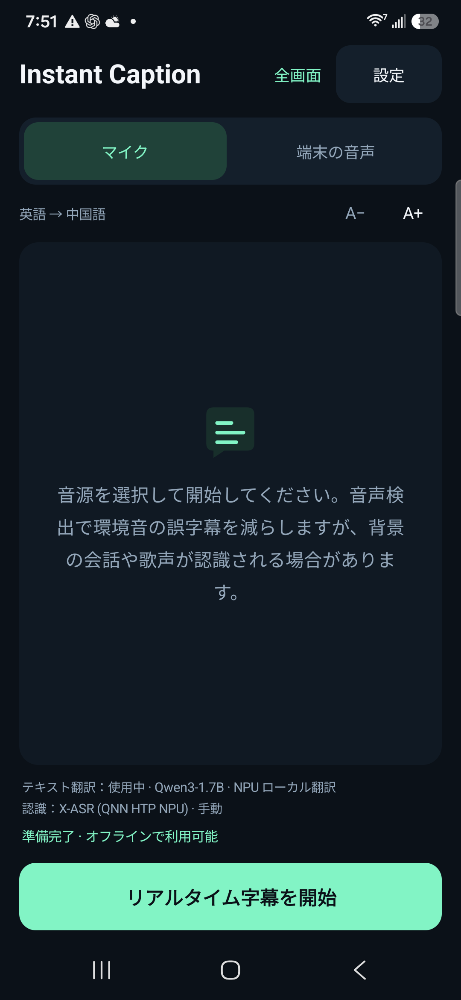
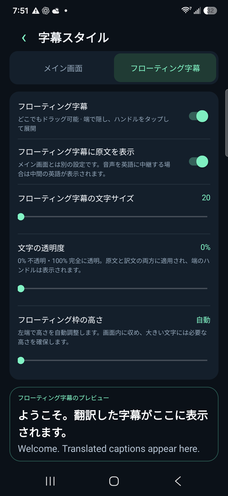

# Instant Caption · 無料の AI 同時通訳アプリ

[English](../../README.md) · [简体中文](../../README.zh-CN.md) · [Español](README.es.md) · [Français](README.fr.md) · [Deutsch](README.de.md) · [Português](README.pt.md) · [Русский](README.ru.md) · [日本語](README.ja.md) · [한국어](README.ko.md) · [العربية](README.ar.md)

## Android 向けオフライン翻訳 · リアルタイム字幕 · 低遅延

Instant Caption は、Android 向けの無料・オープンソースの AI 同時通訳・音声翻訳アプリです。スマートフォン上で動くローカル大規模言語モデル（LLM）を使い、リアルタイム翻訳字幕やフローティング字幕を表示します。モデルのダウンロード後は、音声認識と翻訳をオフラインで実行できます。マイク音声や録音を許可する動画・アプリの音声を低遅延で翻訳します。サブスクリプション、クラウド翻訳の API キー、Google Play 開発者サービスは不要です。寄付は任意です。

[**APK をダウンロード**](https://github.com/zmxhot/InstantCaption/releases/tag/v1.20.1-beta.1)

> Android 10 以降・ARM64 向けの公開ベータです。配布中の署名済み APK は CPU モデルを使用します。NPU 連携はソースに含まれますが、一部のバイナリ依存関係のライセンス確認が残るため、完全版 NPU APK の公開は保留しています。[配布状況](../NPU-DISTRIBUTION.md)

### 主な機能

- モデルのダウンロード後は、端末内で音声認識と翻訳。Google Play 開発者サービスは必須ではありません。
- HY-MT2-1.8B による直接の多言語翻訳、または小型 OPUS-MT の経路を選択。完全版ソースは対応 NPU の Qwen/Gemma も統合しています。
- マイク入力、または Android の音声キャプチャを許可したアプリの音声を使用。
- ドラッグ可能なフローティング字幕と画面端への収納。文字サイズ、透明度、高さ、原文表示を設定可能。
- 音声認識モデルと翻訳モデルを別々に管理。ダウンロード再開、インポート、整合性確認に対応。
- 10 言語の画面表示。音声と字幕の対応言語はモデルによって異なります。

### スクリーンショット

  
  

*Galaxy S25+ の NPU 開発版で撮影した日本語の実機画面です。プレビューには翻訳文と英語の原文が表示されます。公開 APK は CPU モデルを使用します。*

### 使い方

1. `instant-caption-1.20.1-beta.1-portable-release.apk` をインストールします。自分でビルドする必要はありません。
2. 入力言語と字幕言語を選び、Wi-Fi で推奨モデルをダウンロードします。
3. 直接の多言語モデル翻訳には、対応端末で HY-MT2-1.8B を選択できます。テキストモデルは約 1.13 GB、音声モデルは別途必要です。RAM は 6 GB 以上を推奨します。
4. ローカルモデルチェックを実行し、マイクか端末音声を選択して必要な権限を許可します。モデルの準備後はオフラインで利用できます。

遅延は機種、モデル、温度に左右されます。英語 README の NPU 測定値は配布中の CPU APK の性能ではありません。誤訳は起こり得ます。画面共有の許可は音声取得に使い、画面の画像や動画は記録しません。通話や保護されたコンテンツは取得できない場合があります。

[互換性](../COMPATIBILITY.md) · [プライバシー](../../PRIVACY.md) · [ビルド](../BUILD.md) · [問題を報告](https://github.com/zmxhot/InstantCaption/issues) · [任意の寄付](../SUPPORT.md)

アプリのソースは Apache-2.0。モデルとライブラリには個別のライセンスと用途制限があります。寄付による機能制限の解除はありません。
