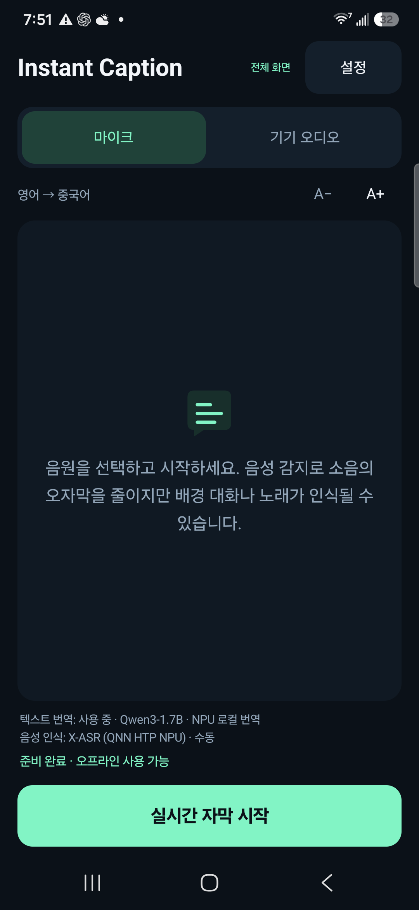
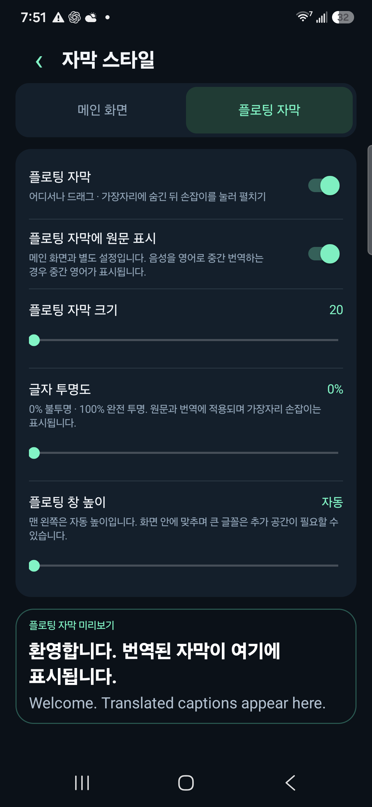

# Instant Caption · 무료 AI 동시통역 앱

[English](../../README.md) · [简体中文](../../README.zh-CN.md) · [Español](README.es.md) · [Français](README.fr.md) · [Deutsch](README.de.md) · [Português](README.pt.md) · [Русский](README.ru.md) · [日本語](README.ja.md) · [한국어](README.ko.md) · [العربية](README.ar.md)

## 낮은 지연 시간 · 휴대폰 로컬 언어 모델 · Android

음성을 실시간 번역 자막으로 바꿉니다. AI 언어 모델이 휴대폰에서 실행되며, 무료로 사용할 수 있습니다. 구독이나 클라우드 번역 API 키가 필요하지 않습니다. 후원은 선택 사항입니다.

[**APK 다운로드**](https://github.com/zmxhot/InstantCaption/releases/tag/v1.20.1-beta.1)

> Android 10 이상, ARM64용 공개 베타입니다. 현재 배포되는 서명된 APK는 CPU 모델을 사용합니다. 소스에는 NPU 통합이 포함되지만, 일부 바이너리 의존성의 라이선스 관계를 확인 중이므로 전체 NPU APK 공개는 보류합니다. [배포 상태](../NPU-DISTRIBUTION.md)

### 주요 기능

- 모델 다운로드 후 음성 인식과 번역을 로컬로 수행하며 Google Play 서비스가 필수는 아닙니다.
- HY-MT2-1.8B로 직접 다국어 번역하거나 더 작은 OPUS-MT 경로를 선택할 수 있습니다. 전체 통합은 호환 NPU용 Qwen/Gemma도 지원합니다.
- 마이크 또는 Android 오디오 캡처를 허용하는 앱의 소리를 사용합니다.
- 드래그 가능한 플로팅 자막과 화면 가장자리 숨김, 글꼴 크기·투명도·높이·원문 표시 설정을 제공합니다.
- 음성 모델과 텍스트 모델을 별도로 관리하고 다운로드 재개, 가져오기, 무결성 검사를 지원합니다.
- 인터페이스 언어는 10개이며, 음성 및 번역 언어는 선택한 모델에 따라 달라집니다.

### 스크린샷

  
  

*Galaxy S25+의 NPU 개발 버전에서 촬영한 한국어 화면입니다. 미리보기에는 번역문과 영어 원문이 표시됩니다. 공개 APK는 CPU 모델을 사용합니다.*

### 시작하기

1. `instant-caption-1.20.1-beta.1-portable-release.apk`를 설치합니다. 직접 컴파일할 필요가 없습니다.
2. 원본 언어와 자막 언어를 선택하고 Wi-Fi로 권장 모델을 다운로드합니다.
3. 직접 다국어 언어 모델 번역에는 호환 기기에서 HY-MT2-1.8B를 선택할 수 있습니다. 텍스트 모델 약 1.13 GB와 별도 음성 모델이 필요하며 RAM 6 GB 이상을 권장합니다.
4. 로컬 모델 검사를 실행하고 마이크 또는 기기 소리를 선택한 뒤 필요한 권한을 허용합니다. 모델 준비 후에는 오프라인으로 사용할 수 있습니다.

지연 시간은 기기, 모델, 온도에 따라 달라집니다. 영어 README의 NPU 수치는 배포되는 CPU APK 성능을 의미하지 않습니다. 번역 오류가 발생할 수 있습니다. 화면 공유 권한은 오디오를 얻는 데 사용하며 화면 이미지나 동영상을 캡처하지 않습니다. 통화나 보호된 콘텐츠는 사용할 수 없을 수 있습니다.

[호환성](../COMPATIBILITY.md) · [개인정보](../../PRIVACY.md) · [빌드](../BUILD.md) · [문제 신고](https://github.com/zmxhot/InstantCaption/issues) · [선택적 후원](../SUPPORT.md)

앱 소스는 Apache-2.0이며 모델과 라이브러리는 각각의 라이선스 및 용도 제한을 따릅니다. 후원 없이도 제공되는 모든 기능을 사용할 수 있습니다.
