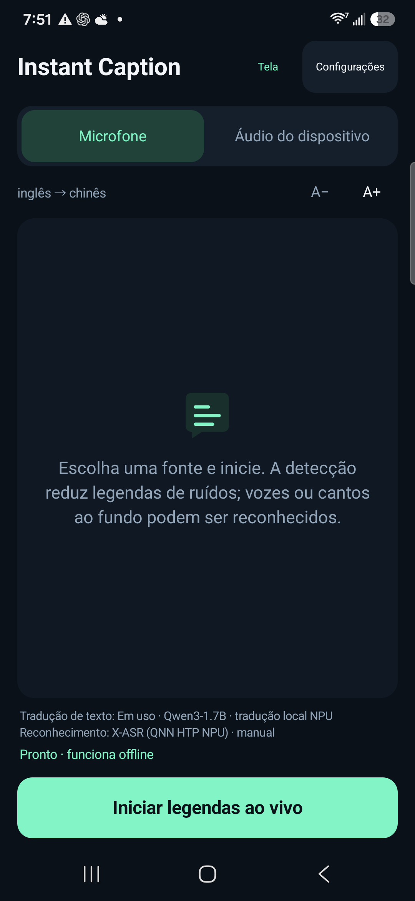
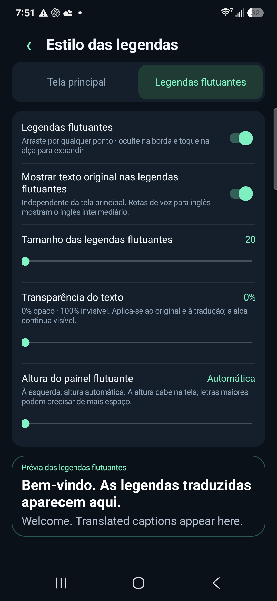

# Instant Caption · Interpretação simultânea com IA gratuita

[English](../../README.md) · [简体中文](../../README.zh-CN.md) · [Español](README.es.md) · [Français](README.fr.md) · [Deutsch](README.de.md) · [Português](README.pt.md) · [Русский](README.ru.md) · [日本語](README.ja.md) · [한국어](README.ko.md) · [العربية](README.ar.md)

## Tradutor offline para Android · Legendas em tempo real · Baixa latência

Instant Caption é um aplicativo gratuito e de código aberto de tradução de voz e interpretação simultânea com IA para Android. Oferece legendas em tempo real e legendas flutuantes usando grandes modelos de linguagem (LLMs) executados no celular. Após baixar os modelos, o reconhecimento de fala e a tradução funcionam offline. Traduza o microfone ou o áudio de vídeos e aplicativos compatíveis com baixa latência. Sem assinatura, chave de API de tradução na nuvem ou dependência do Google Play Services. Doações são opcionais.

[**Baixar APK**](https://github.com/zmxhot/InstantCaption/releases/tag/v1.20.1-beta.1)

> Beta pública para Android 10+ e ARM64. O APK assinado disponível usa modelos de CPU. A integração NPU está no código, mas o APK NPU completo ainda aguarda esclarecimentos sobre licenças de dependências binárias. [Status de distribuição](../NPU-DISTRIBUTION.md).

### Recursos

- Reconhecimento de fala e tradução locais após baixar os modelos, sem exigir Google Play Services.
- HY-MT2-1.8B para tradução multilíngue direta ou rotas OPUS-MT menores. A integração completa suporta versões Qwen/Gemma para NPUs compatíveis.
- Microfone ou áudio de aplicativos que permitam a captura do Android.
- Legendas flutuantes arrastáveis, ocultação na borda, fonte, transparência, altura e texto original configuráveis.
- Listas separadas de modelos de fala e texto, downloads retomáveis, importação e verificação de integridade.
- Interface em dez idiomas; os idiomas de fala e tradução dependem dos modelos.

### Capturas de tela

  
  

*Interface em português, capturada em um Galaxy S25+ com a versão NPU de desenvolvimento. A prévia mostra a tradução e o texto original em inglês. O APK público usa modelos de CPU.*

### Como começar

1. Instale `instant-caption-1.20.1-beta.1-portable-release.apk`. Não é preciso compilar.
2. Escolha os idiomas de origem e destino e baixe os modelos recomendados por Wi-Fi.
3. Para tradução direta com modelo de linguagem, escolha HY-MT2-1.8B quando compatível: cerca de 1,13 GB, além do modelo de fala; recomendamos 6 GB de RAM ou mais.
4. Execute a verificação local, selecione microfone ou áudio do dispositivo e conceda a permissão correspondente. Com os modelos prontos, é possível usar sem conexão.

A latência depende do aparelho, modelo e temperatura. As medições NPU do README em inglês não representam o APK CPU. Traduções podem conter erros. O consentimento de compartilhamento de tela do Android é usado para obter áudio, sem capturar imagens ou vídeo. Chamadas e conteúdo protegido podem não estar disponíveis.

[Compatibilidade](../COMPATIBILITY.md) · [Privacidade](../../PRIVACY.md) · [Compilar](../BUILD.md) · [Relatar problema](https://github.com/zmxhot/InstantCaption/issues) · [Doação opcional](../SUPPORT.md)

Código do aplicativo: Apache-2.0. Modelos e bibliotecas mantêm suas próprias licenças e restrições. Nenhum recurso exige doação.
