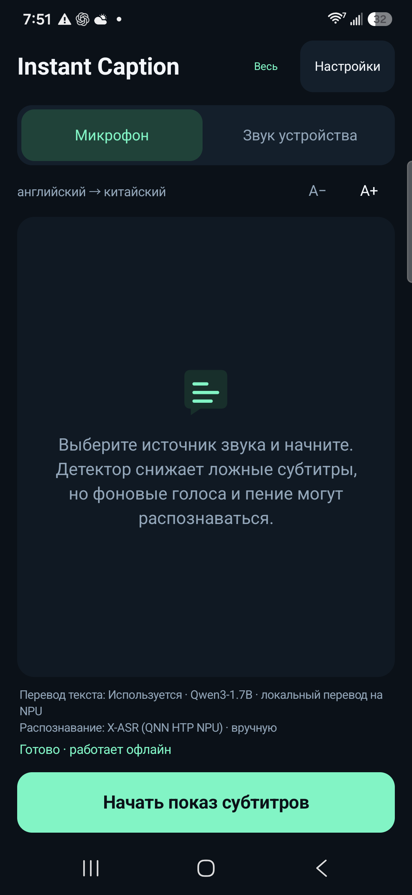
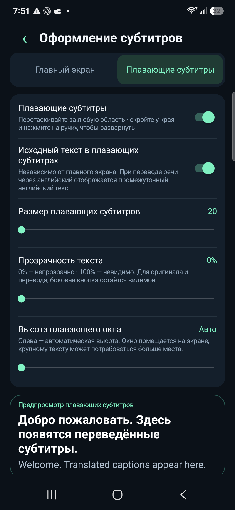

# Instant Caption · Бесплатный синхронный перевод с ИИ

[English](../../README.md) · [简体中文](../../README.zh-CN.md) · [Español](README.es.md) · [Français](README.fr.md) · [Deutsch](README.de.md) · [Português](README.pt.md) · [Русский](README.ru.md) · [日本語](README.ja.md) · [한국어](README.ko.md) · [العربية](README.ar.md)

## Низкая задержка · Локальные языковые модели · Android

Приложение превращает речь в переводные субтитры в реальном времени. Языковые модели работают на вашем телефоне. Бесплатно, без подписки и ключа API облачного перевода. Пожертвования добровольны.

[**Скачать APK**](https://github.com/zmxhot/InstantCaption/releases/tag/v1.20.1-beta.1)

> Публичная бета для Android 10+ и ARM64. Доступный подписанный APK использует CPU. Интеграция NPU включена в исходный код; полный NPU APK пока не публикуется из-за неуточнённых лицензий некоторых бинарных зависимостей. [Статус распространения](../NPU-DISTRIBUTION.md).

### Возможности

- Локальное распознавание и перевод после загрузки моделей, без обязательных сервисов Google Play.
- HY-MT2-1.8B для прямого многоязычного перевода или более компактные маршруты OPUS-MT. Полная интеграция поддерживает соответствующие NPU-версии Qwen/Gemma.
- Микрофон или звук приложений, разрешающих захват аудио Android.
- Перемещаемые плавающие субтитры со скрытием у края; настройка шрифта, прозрачности, высоты и исходного текста.
- Раздельные списки речевых и текстовых моделей, возобновляемые загрузки, импорт и проверка целостности.
- Десять языков интерфейса; языки речи и перевода зависят от выбранных моделей.

### Снимки экрана

  
  

*Русский интерфейс, снятый на Galaxy S25+ в сборке для разработки с NPU. В предпросмотре показаны перевод и английский оригинал. Опубликованный APK использует модели для CPU.*

### Начало работы

1. Установите `instant-caption-1.20.1-beta.1-portable-release.apk`. Компиляция не нужна.
2. Выберите исходный и целевой языки, скачайте рекомендуемые модели по Wi-Fi.
3. Для прямого перевода языковой моделью выберите HY-MT2-1.8B, если устройство поддерживается: около 1,13 ГБ плюс речевая модель; желательно от 6 ГБ ОЗУ.
4. Выполните локальную проверку моделей, выберите микрофон или звук устройства и выдайте соответствующее разрешение. После подготовки моделей можно работать офлайн.

Задержка зависит от устройства, модели и температуры. NPU-результаты английского README не описывают CPU APK. Возможны ошибки перевода. Разрешение Android на показ экрана используется для получения аудио; изображения и видео экрана не записываются. Звонки и защищённые материалы могут быть недоступны.

[Совместимость](../COMPATIBILITY.md) · [Конфиденциальность](../../PRIVACY.md) · [Сборка](../BUILD.md) · [Сообщить об ошибке](https://github.com/zmxhot/InstantCaption/issues) · [Добровольная поддержка](../SUPPORT.md)

Код приложения: Apache-2.0. У моделей и библиотек отдельные лицензии и ограничения. Пожертвования не открывают дополнительных функций.
